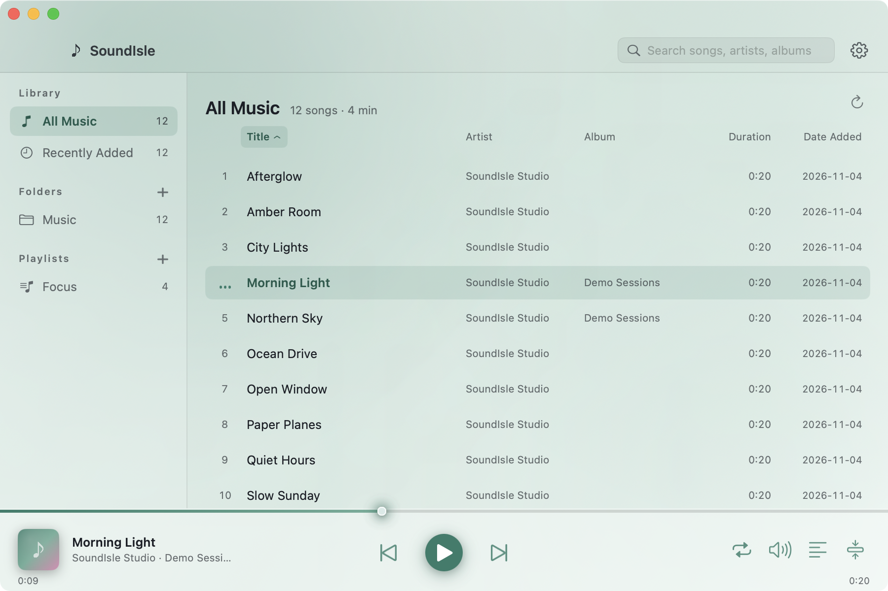
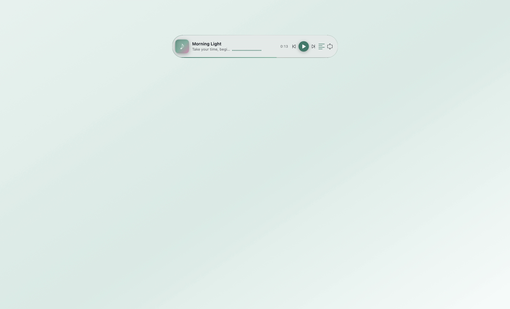
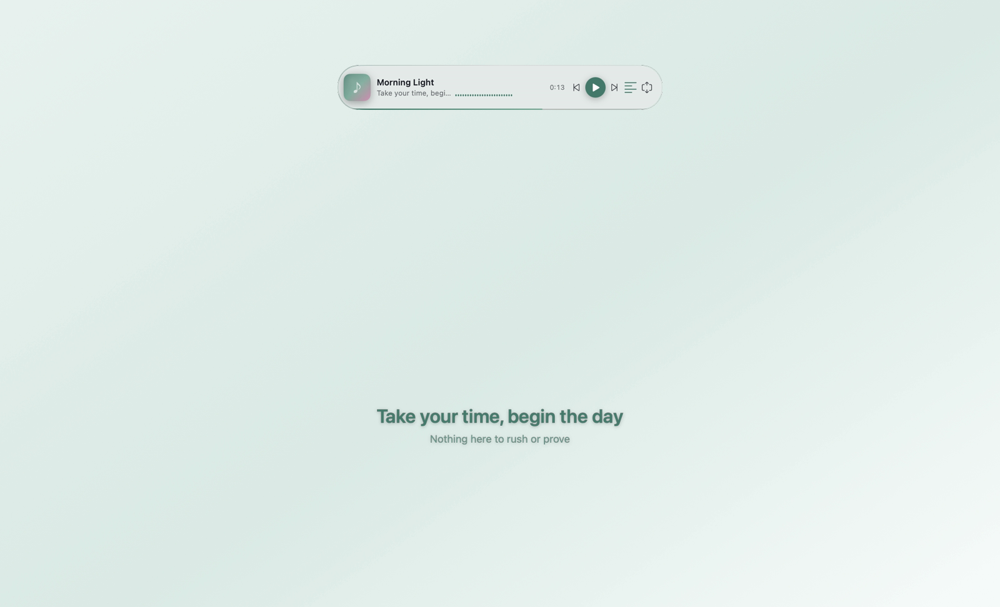
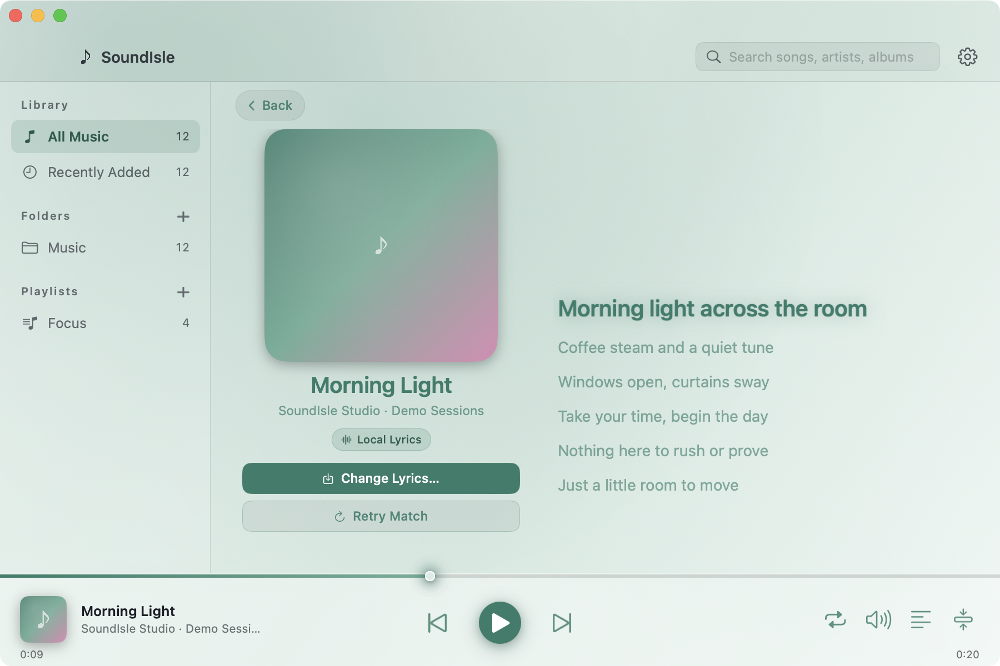
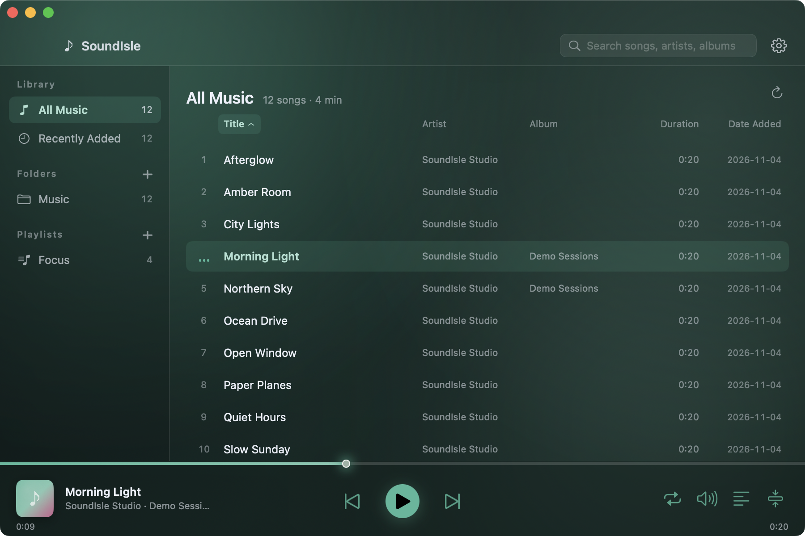

# SoundIsle

[中文 README](README.md)


A native macOS player built for **listening to your local music while working**: fast to open, light on resources, and quiet by design. It scans folders recursively, manages playlists, lives in the menu bar, supports a mini player and floating desktop lyrics, repairs tags and garbled text, organizes files by tags, and transcodes non-native formats in the background.

## Screenshots

### Main window: your local library


Scan folders recursively, read tags, artwork and durations, and sort by title, artist, album or length. The sidebar holds the library, folders and playlists.

### Mini player: for working


Switching to the mini player tucks the main window away and leaves a small always-available strip that never steals focus. It shows the current lyric line and has a desktop-lyrics toggle.

### Desktop lyrics: sing along


Lyrics float transparently over the desktop. Drag, resize, or lock them to click through; hovering a locked overlay reveals a small pill for dragging or unlocking. Two lines show the current and next line, following the system light/dark appearance.

### Lyrics page


Click the cover in the player bar to switch between the track list and the full lyrics page.

### Light and dark themes
| Light | Dark |
| --- | --- |
|  |  |

Six palettes — celadon, deep blue, morning, ink, berry and sea salt — follow the system appearance or pin to light or dark.

## Why SoundIsle

- **Native and light**: SwiftUI + AppKit + AVFoundation. Idle CPU is effectively zero; playback usually sits around 1–3%, with tens of MB of memory.
- **Actually background-friendly**: a menu-bar item, a mini player that never steals focus, Space/⌘←/⌘→ in the main window, and system media keys everywhere.
- **Sing along**: same-name `.lrc` first, then LRCLIB online matching, then manual import. Desktop lyrics are frosted, always-on-top, click-through when locked, and follow system light/dark; hovering a locked overlay still lets you drag or unlock it.
- **Fix downloaded music**: tag editing, GBK/UTF-8 mojibake repair, batch edits and undo for MP3/FLAC/MP4/APE and more.
- **Format tolerant**: ape/wma/ogg/opus/dsf and friends are decoded by your local ffmpeg and cached as ALAC in the background.
- **Pleasant to look at**: six celadon/deep-blue/morning/ink/berry/sea-salt palettes, system light/dark, custom accent and a live spectrum.
- **Bilingual**: follows the system language, with a 中文 / English override in Settings.

## Features

### Library and playlists

- Drag in files or folders; recursive scan with tags, artwork and duration. Falls back to “Artist - Title” filenames when tags are missing.
- All Music, Recently Added, folders, user playlists; search, sort and drag to reorder.
- Sequential / repeat all / repeat one / shuffle; remembers the queue, track and position.

### Playback, menu bar and mini player

- Menu-bar menu: play/pause, previous, next, mini mode, lyrics, quit.
- Mini player: artwork, title, current lyric, spectrum and transport; draggable, remembers its position, visible across Spaces.
- Media keys F7/F8/F9; Space/⌘←/⌘→ in the main window.
- Mini player and desktop lyrics are hidden from screen recording by default; can be changed in Settings.

### Lyrics

- Same-name `.lrc` → LRCLIB online match → manual import/override, cached locally.
- Click the player-bar artwork for a large “cover + synced lyrics” page with the current line highlighted and auto-scrolled.
- Desktop lyrics are text-only by default; hover shows a frosted background and controls. Locking makes them click-through so they never block your work.
- Adjustable size (follows window width), one/two lines, opacity, text outline, and a custom LRCLIB-compatible lyrics endpoint.

### Tags and file organization

- Edit title, artist, album, album artist, year, track number, genre and artwork; batch edits included.
- Detects GBK/GB18030/Windows-1252 text misdecoded as Latin-1, previews the repair, and keeps an undo history.
- Organize files with templates such as `Artist/Album/Track Title`; preview first, auto-number name conflicts, never overwrite, undo available.
- Rescan detects renamed files with identical size + modification date, preserving track IDs and playlists.

### Appearance

- One frosted-glass material: a single light celadon gradient across the window; no stray white sidebar/player panels.
- Six palettes + custom accent; light, dark or follow system.
- Spectrum in the mini player and an optional faint spectrum under the main player bar.

## Download

- Get the latest universal build (Intel + Apple Silicon) from [Releases](https://github.com/y8gao/soundisle/releases/latest).
- Requires **macOS 12.0+**.
- The app is ad-hoc signed and not notarized. If macOS blocks the first launch, right-click → Open, or run:
  ```bash
  xattr -dr com.apple.quarantine /Applications/声屿.app
  ```

## Build from source

```bash
# 1. Build static TagLib (first run or when Vendor/taglib is missing; safe to re-run)
bash Scripts/build-taglib.sh

# 2. Run unit tests
swift test

# 3. Build build/声屿.app as a universal binary (x86_64 + arm64)
bash Scripts/build-app.sh --universal
```

Output: `build/声屿.app`. Requires Xcode Command Line Tools (Swift 5.8+), `cmake` and `git`; `ffmpeg` is optional and only needed for non-native formats.

## Keyboard shortcuts

| Key | Action |
| --- | --- |
| `Space` | Play / pause (main window, not while typing) |
| `⌘←` / `⌘→` | Previous / next track |
| `←` / `→` | Seek back / forward 5 seconds |
| `⌘F` | Focus search |
| `⌘,` | Open Settings |

## Dependencies

- **TagLib 1.13.1**: downloaded and built as a static library by `Scripts/build-taglib.sh`, linked into the app.
- **FFmpeg**: external command-line tool, not bundled. Only `ape/wma/ogg/opus/wv/tta/dsf/dff` and similar non-native formats need it; mp3/m4a/m4r/aac/wav/aiff/flac/mp4/alac do not.
  - Recommended install: `brew install ffmpeg`.
  - Lookup order: custom path in Settings → `/usr/local/bin`, `/opt/homebrew/bin` → current `PATH`.
  - Choose the `ffmpeg` executable in Settings → Cache → FFmpeg path.

## Data directory

```
~/Library/Application Support/SoundIsle/
├── library.json       # library index (with .bak backup)
├── playlists.json     # playlists
├── settings.json      # settings and last playback position
├── covers/            # artwork cache
├── lyrics/            # online lyrics cache and manual overrides
├── transcode/         # ALAC transcode cache
└── undo/              # tag-edit and organizer undo records
```

A corrupt index falls back to `.bak`; playlists and settings live in separate files. The transcode cache can be cleared without touching original audio.

## License and credits

- This project's own source is licensed under the **MIT License**; see [`LICENSE`](LICENSE).
- **TagLib**: GNU LGPL-2.1 or MPL-1.1 (see upstream), linked statically.
- **FFmpeg**: the license depends on the build (common `--enable-gpl` static builds are GPL); not distributed with the app. Install it yourself and follow its license.

## Support

SoundIsle is free and open source. If it saves you time:

- Give the project a **Star**, or share it with someone who keeps a local music library;
- Open an Issue or PR, or tell me about your use case;
- Sponsorship links (GitHub Sponsors / Afdian) will be added here once available. Donations are optional and never unlock features.

## Known limitations

- FFmpeg is not bundled; non-native formats cannot play without it, while native formats are unaffected.
- No live folder watching; use “Rescan” after changing files outside the app.
- No streaming or online music. Online lyrics use LRCLIB by default; a compatible custom endpoint can be configured.
- Copy mode for the organizer creates a second copy; a later rescan of the source folder can show duplicate entries.
- WAV files without an existing ID3v2 chunk are read-only; WMA/ASF album-artist and artwork fields are read-only.
- Media keys only reach SoundIsle while it is the system Now Playing app.
- The app is ad-hoc signed; rebuilding can reset system permission records.
- The app does not record microphone input. If macOS asks for microphone access, denying it does not affect playback.
- The lyrics overlay and mini player are hidden from screen recording/screenshots by default; this can be disabled in Settings.
