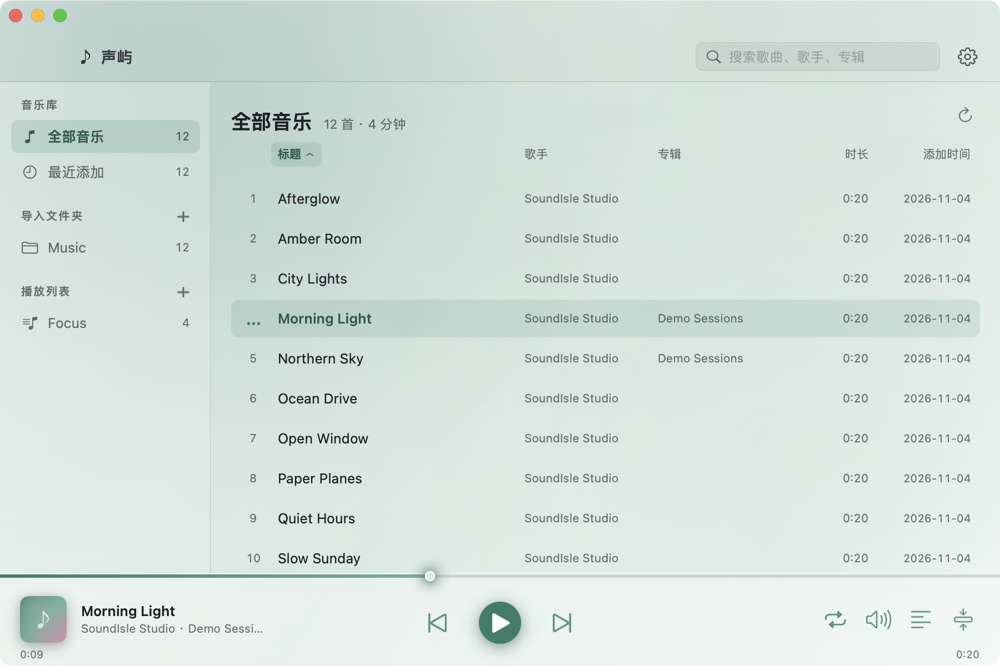
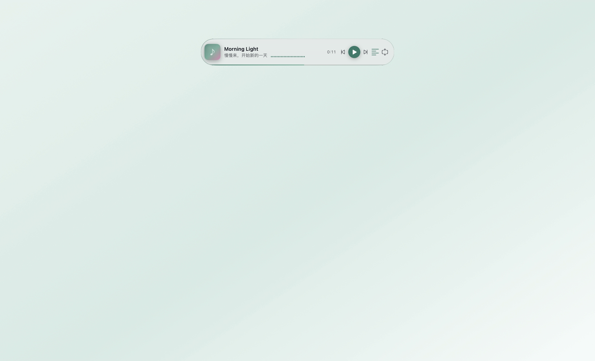
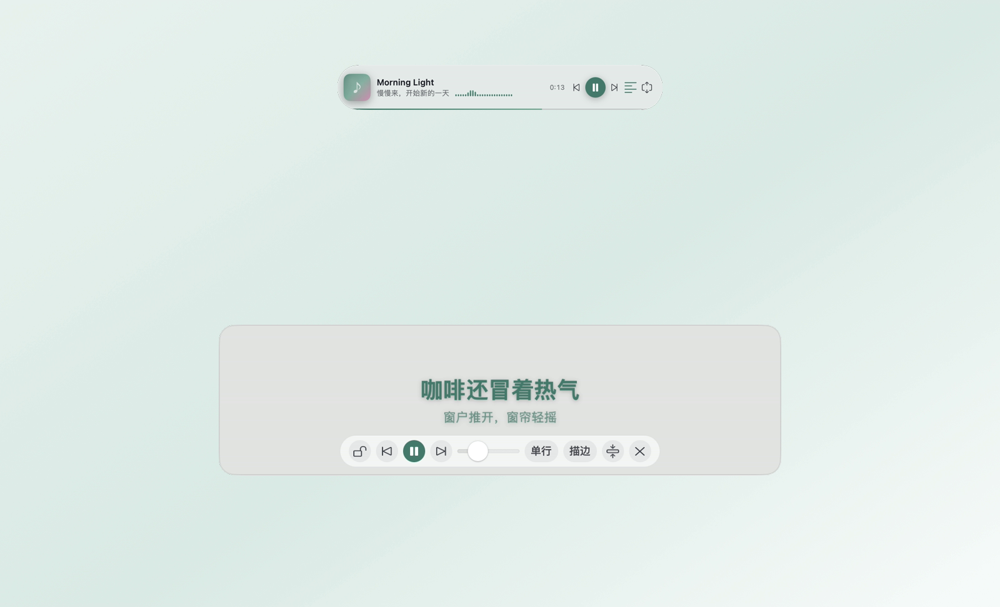
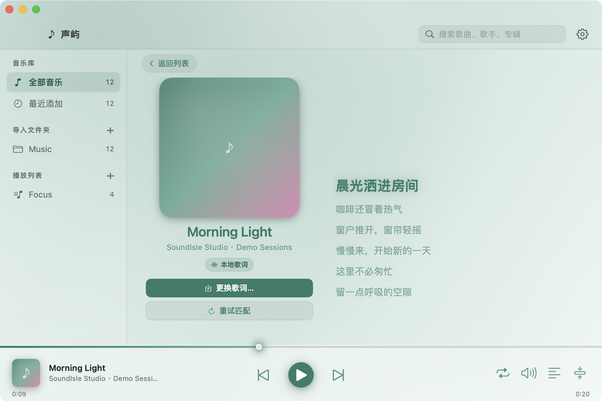
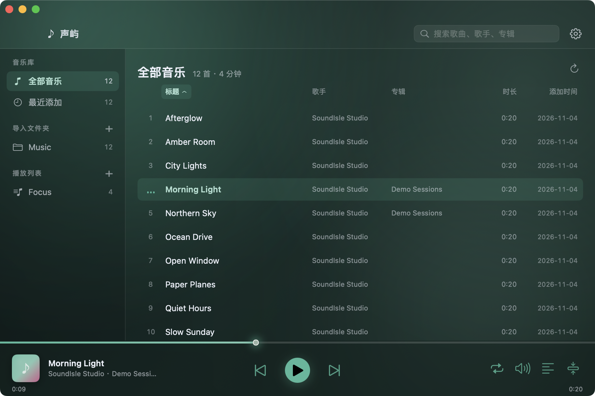

# 声屿 SoundIsle

[English README](README.en.md)


一款为**工作时听本地音乐**而生的原生 macOS 播放器：启动快、资源占用低、界面安静。支持递归扫描音乐文件夹、播放列表、菜单栏与媒体键、迷你窗、桌面歌词、标签修复、按标签整理文件，以及系统不支持的格式后台转码。

## 截图

### 主窗口：本地音乐库


递归导入文件夹，读取标签、封面与时长，按标题、歌手、专辑、时长排序；左侧是音乐库、文件夹与播放列表。

### 迷你窗口：工作时的小窗


切到迷你窗后主窗口自动收起，小窗常驻桌面，不抢焦点，适合边工作边听；窗内显示当前歌词，并带有桌面歌词开关。

### 桌面歌词：跟唱模式


歌词透明悬浮在桌面上，可拖动、拖拽边缘缩放、锁定穿透；悬停会出现控制条，上一首/播放/下一首都在里面。锁定后悬停出现小胶囊，同样可以切歌和解锁。双行显示当前与下一句，跟随系统浅色/深色外观。

### 歌词页


点击播放条封面，即可在歌曲列表与歌词页之间切换。

### 浅色与深色主题
| 浅色 | 深色 |
| --- | --- |
|  |  |

内置青瓷、深空、晨光、墨黑、莓紫、海盐六套配色，可跟随系统外观，也可固定浅色或深色。

## 为什么是声屿

- **原生、轻量**：SwiftUI + AppKit + AVFoundation，空闲几乎不占 CPU，播放时通常 1–3%，内存几十 MB。
- **真的在后台**：菜单栏常驻，迷你窗不抢焦点，空格/⌘←/⌘→ 在主窗控制播放，媒体键全局可用。
- **看歌词跟唱**：同名 `.lrc` 优先，其次 LRCLIB 在线匹配，也可手动导入；桌面歌词磨砂悬浮、锁定穿透、跟系统明暗。悬停可切歌，锁定后仍有播放控制和解锁小胶囊。
- **把下载来的歌修好**：标签编辑、GBK/UTF-8 乱码修复、批量修改、撤销，支持 MP3/FLAC/MP4/APE 等。
- **不挑格式**：系统不支持的 ape/wma/ogg/opus/dsf 等由本机 ffmpeg 后台转成 ALAC 缓存。
- **顺眼**：六套青瓷/深空/晨光/墨黑/莓紫/海盐配色，明暗跟随系统，自定义强调色与实时频谱。
- **中英双语**：跟随系统，也可在设置中强制中文或 English。

## 功能

### 音乐库与播放列表

- 拖入文件或文件夹递归扫描，读取标签、封面、时长；没有标签时按“歌名-歌手”文件名兜底。
- 全部音乐、最近添加、按导入文件夹分组、手动播放列表；搜索、排序、拖拽排序。
- 顺序/列表循环/单曲循环/随机；记住上次队列、歌曲与播放位置。

### 播放、菜单栏与迷你窗

- 菜单栏图标常驻：播放/暂停、上一首、下一首、迷你模式、歌词、退出。
- 迷你窗：封面、歌名、当前歌词、频谱、控制按钮，可拖动、记住位置、跨桌面显示。
- 系统媒体键 F7/F8/F9；主窗空格/⌘←/⌘→。
- 屏幕录制/共享时默认隐藏迷你窗与桌面歌词，可在设置中关闭。

### 歌词

- 同目录同名 `.lrc` → LRCLIB 在线匹配 → 手动导入/覆盖；结果本地缓存。
- 主窗点封面进入「封面 + 同步歌词」页，当前句高亮并自动滚动。
- 桌面歌词默认只显示文字，鼠标悬停显示磨砂背景和控件；锁定后鼠标穿透，不挡工作。
- 控制条内含上一首 / 播放暂停 / 下一首；锁定后的小胶囊同样带播放控制和解锁，不用切回主窗。
- 字号随窗口宽度自动缩放；拖动窗口边缘或缩放手柄即可调整，锁定前调好即可。
- 单/双行、透明度、文字描边；支持自定义兼容 LRCLIB 的歌词源地址。

### 标签与文件整理

- 编辑标题、歌手、专辑、专辑歌手、年份、曲目号、流派、封面；支持批量。
- 自动识别 GBK/GB18030/Windows-1252 被错误解码的中文乱码，预览后应用；保留撤销记录。
- 按模板把文件整理到 `歌手/专辑/曲目 歌名` 等路径；执行前预览，冲突自动编号，不覆盖，可撤销。
- 重新扫描能识别同大小+同修改时间的文件改名，保留歌曲 ID 与播放列表。

### 外观

- 磨砂玻璃统一底材质，整窗一块浅青瓷渐变；侧栏/播放条不再出现突兀白块。
- 六套配色 + 自定义强调色；浅色/深色/跟随系统。
- 迷你窗频谱，主窗播放条可选底部频谱。

## 下载

- 前往 [Releases](https://github.com/y8gao/soundisle/releases/latest) 下载最新通用包（Intel + Apple Silicon）。
- 要求 **macOS 12.0+**。
- 应用为 ad-hoc 签名、未公证；首次打开如被拦截，右键 → 打开，或执行：
  ```bash
  xattr -dr com.apple.quarantine /Applications/声屿.app
  ```

## 从源码构建

```bash
# 1. 构建静态 TagLib（首次或 Vendor/taglib 缺失时；脚本可重复执行）
bash Scripts/build-taglib.sh

# 2. 运行单元测试
swift test

# 3. 生成 build/声屿.app（x86_64 + arm64）
bash Scripts/build-app.sh --universal
```

产物：`build/声屿.app`。需要 Xcode Command Line Tools（Swift 5.8+）、`cmake` 与 `git`；`ffmpeg` 可选，仅用于非原生格式。

## 快捷键

| 按键 | 功能 |
| --- | --- |
| `空格` | 播放 / 暂停（主窗口且未在输入） |
| `⌘←` / `⌘→` | 上一首 / 下一首 |
| `←` / `→` | 后退 / 前进 5 秒 |
| `⌘F` | 聚焦搜索框 |
| `⌘,` | 打开设置 |

## 依赖说明

- **TagLib 1.13.1**：由 `Scripts/build-taglib.sh` 下载并编译为静态库，链接进应用。
- **FFmpeg**：外部命令行工具，不打包进应用。只有 `ape/wma/ogg/opus/wv/tta/dsf/dff` 等非原生格式需要它；mp3/m4a/m4r/aac/wav/aiff/flac/mp4/alac 不依赖 FFmpeg。
  - 推荐安装：`brew install ffmpeg`。
  - 查找顺序：设置中的自定义路径 → `/usr/local/bin`、`/opt/homebrew/bin` → 当前 `PATH`。
  - 在「设置 → 缓存 → FFmpeg 路径」可手动选择 `ffmpeg`。

## 数据目录

```
~/Library/Application Support/SoundIsle/
├── library.json       # 曲库索引（含 .bak 备份）
├── playlists.json     # 播放列表
├── settings.json      # 设置与上次播放位置
├── covers/            # 封面缓存
├── lyrics/            # 在线歌词缓存与手动覆盖
├── transcode/         # 非原生格式转码缓存（ALAC）
└── undo/              # 标签编辑与整理撤销记录
```

索引损坏时会回退到 `.bak`；播放列表与设置独立保存。转码缓存可清理，不会删除原始音乐文件。

## 许可与致谢

- 本项目自身代码采用 **MIT License**，见 [`LICENSE`](LICENSE)。
- **TagLib**：GNU LGPL-2.1 或 MPL-1.1（以 TagLib 上游为准），以静态库方式链接。
- **FFmpeg**：许可证取决于具体构建（常见 `--enable-gpl` 静态构建为 GPL）；不随应用分发，由用户自行安装，请遵循其许可证。

## 支持开发

声屿是免费、开源的。如果它帮你省了时间：

- 给项目点一个 **Star**，或分享给同样在用本地音乐的人；
- 提交 Issue / PR，或告诉我你的使用场景；
- 捐赠入口（GitHub Sponsors / 爱发电）开通后会放在这里，完全自愿，不影响任何功能。

## 已知限制

- 不打包 FFmpeg；缺少 FFmpeg 时非原生格式无法播放，但原生格式不受影响。
- 不做实时文件夹监听：外部增删文件后需要手动「重新扫描」。
- 不做在线音乐/流媒体；在线歌词默认查询 LRCLIB，可在设置中填写兼容的歌词源。
- 整理文件的「复制」模式会在目标位置新增副本；再次扫描源文件夹时可能出现重复条目。
- 没有 ID3v2 标签块的 WAV 为只读；WMA/ASF 的专辑歌手与封面为只读。
- 媒体键只在声屿是系统当前 Now Playing 应用时到达应用。
- 应用为 ad-hoc 签名；每次重新构建后系统权限记录可能重置。
- 应用不采集麦克风输入；如果 macOS 弹出麦克风权限请求，选择「不允许」不影响播放。
- 桌面歌词与迷你窗默认在屏幕录制/截图中隐藏；可在设置中关闭。
